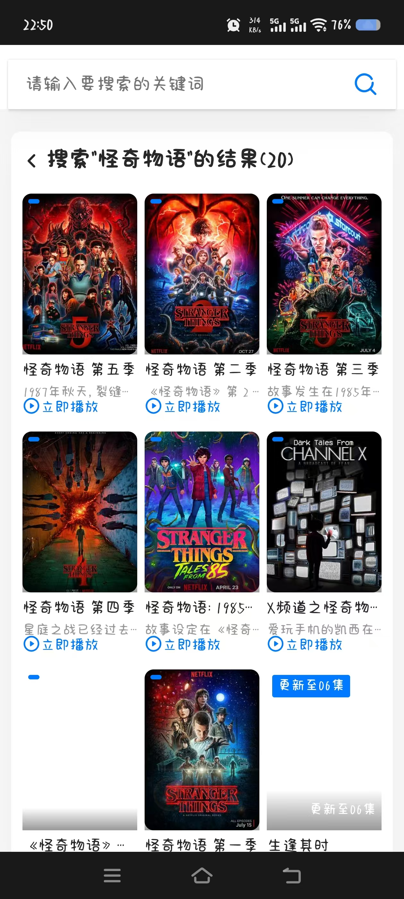
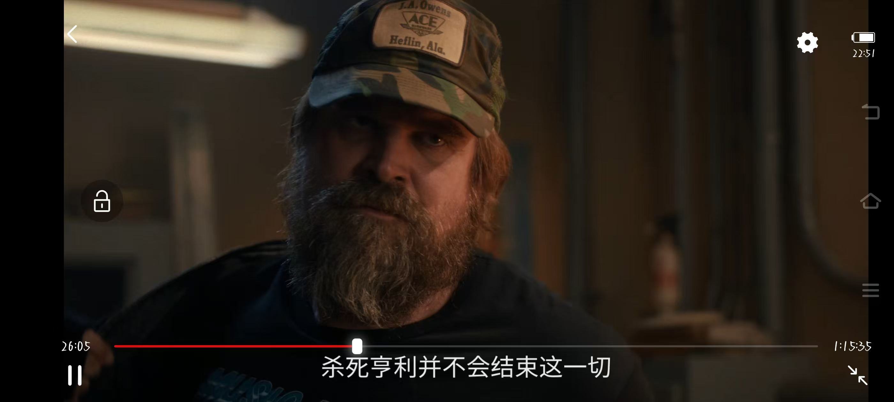

# 茶杯狐 cupfox — Android APK(逆向仿真)

茶杯狐(cupfox.ai)逆向学习项目的 **Android 端**。

> 本仓库仅开源 APK 相关代码。配套的 Web 端(仿站)代码与数据**不开源**,构建 APK 时需要自备(见下文)。

## 项目结构

```
apk/
├── app/
│   ├── build.gradle            # App 模块(Capacitor 风格,WebView + Chaquopy)
│   ├── src/main/
│   │   ├── AndroidManifest.xml
│   │   ├── java/com/cupfox/app/
│   │   │   ├── MainActivity.java        # 主 Activity,加载内置 WebView + JS 桥
│   │   │   ├── BrowserBridge.java       # Android ↔ JS 通信桥
│   │   │   └── VideoPlayerActivity.java # 横屏播放器(FFmpeg 解码 + ExoPlayer)
│   │   ├── python/server_main.py        # 启动内置 Python 服务的入口
│   │   ├── assets/
│   │   │   └── index.html               # 内置 Web UI(打包后随 APK 分发)
│   │   └── jniLibs/arm64-v8a/           # FFmpeg 原生库(需自备,不入库)
│   └── ...
├── build.gradle                # 根工程
├── settings.gradle
├── gradle.properties
├── gradle/wrapper/
├── gradlew / gradlew.bat
└── local.properties            # 本地路径,不入库(.gitignore)
```

## 运行架构

- **WebView** 加载内置 `assets/index.html`(仿站 UI)
- **Chaquopy** 把 Python 打进 APK,启动时拉起内置 Flask/Python 服务(`server_main.py`)
- **FFmpeg**(native so + assets 二进制)在 `VideoPlayerActivity` 中做音视频解码
- 通过 `BrowserBridge` 在 JS 与 Android 原生能力(播放器、文件访问)之间通信

## 本地构建

```bash
# 1. 配置 local.properties(不入库)
echo "sdk.dir=/path/to/android-sdk" > apk/local.properties

# 2. 补齐不入库的二进制
#    - apk/app/src/main/jniLibs/arm64-v8a/libffmpeg.so
#    - apk/app/src/main/assets/ffmpeg、cupfox_ffmpeg
#    以及自备的 Web 端源码(构建脚本会打包)

# 3. 构建
cd apk
./gradlew assembleRelease
```

## 签名

`app/build.gradle` 中的 release 签名密钥改为从环境变量读取(`CUPFOX_KS_PASS` / `CUPFOX_KEY_PASS`),keystore 文件名 `cupfox-release.keystore` 不入库。
发布前请自行创建 keystore 并配置环境变量。

## 运行截图

| 主页(分类 / 热映) | 搜索结果 | 详情 + 播放 | 横屏播放 |
|---|---|---|---|
|  |  |  |  |

## 许可

本项目代码采用 **MIT License**。详见 [LICENSE](LICENSE)。

FFmpeg 原生库与运行其依赖的第三方组件遵循其各自许可证,不随本仓库分发。

> **使用前请阅读 [免责声明 (DISCLAIMER)](DISCLAIMER.md)**。本项目仅供技术研究与逆向学习,不得用于规避原站访问控制或传播盗版内容。
